# CI-Lab — Mise en place d'une chaîne CI/CD

Mise en place d'une chaîne d'intégration continue pour automatiser la construction, l'analyse et la publication d'une application Java.

---

## 📋 Sommaire

1. Présentation
2. Architecture
3. Technologies utilisées
4. Infrastructure
5. Structure du projet
6. Préparation de l'environnement
7. Git et GitHub
8. Maven
9. Nexus Repository
10. Configuration Maven / Nexus
11. Jenkins
12. SonarQube et PostgreSQL
13. Intégration Jenkins / SonarQube
14. Intégration Jenkins / Nexus
15. Pipeline CI
16. Publication de l'artefact
17. Gestion des erreurs
18. Captures d'écran
19. Résultat final
20. Objectifs atteints
21. Conclusion

---

# 1. Présentation

Ce projet consiste à mettre en place une chaîne d'intégration continue permettant d'automatiser les principales étapes du cycle de développement d'une application Java.

L'objectif du laboratoire est de mettre en œuvre une chaîne complète permettant de passer du développement du code source à la génération et à la publication d'un artefact Maven.

## Chaîne globale

    Développement
          │
          ▼
         Git
          │
          ▼
       GitHub
          │
          ▼
       Jenkins
          │
          ▼
        Maven
          │
          ├──────────────► SonarQube
          │
          ▼
         JAR
          │
          ▼
        Nexus

Cette chaîne permet notamment d'automatiser :

- la récupération du code source ;
- la compilation ;
- l'exécution des tests ;
- l'analyse de la qualité du code ;
- la génération du fichier JAR ;
- la publication de l'artefact dans Nexus Repository.

---

# 2. Architecture

## 2.1 Architecture globale

L'architecture du laboratoire repose sur plusieurs machines virtuelles ayant chacune un rôle précis.

    ┌─────────────────┐
    │   Développeur   │
    └────────┬────────┘
             │
             ▼
    ┌─────────────────┐
    │      Git        │
    └────────┬────────┘
             │
             ▼
    ┌─────────────────┐
    │     GitHub      │
    └────────┬────────┘
             │
             ▼
    ┌─────────────────┐
    │     Jenkins     │
    │ 192.168.42.151  │
    └────────┬────────┘
             │
    ┌────────┴────────────┐
    │                     │
    ▼                     ▼
┌──────────────┐    ┌──────────────┐
│  SonarQube   │    │     Nexus    │
│192.168.42.152│    │192.168.42.128│
└──────┬───────┘    └──────────────┘
       │
       ▼
┌──────────────┐
│  PostgreSQL  │
└──────────────┘

### Fichiers d'architecture

Le schéma Draw.io est disponible dans :

    architecture/
    ├── 01-global-architecture.drawio
    └── 01-global-architecture.png

---

# 3. Technologies utilisées

| Technologie | Rôle |
|---|---|
| Git | Versionnement du code source |
| GitHub | Hébergement du dépôt distant |
| Java | Environnement de développement et de compilation |
| Maven | Compilation, tests, packaging et déploiement |
| Jenkins | Automatisation du processus CI |
| SonarQube | Analyse statique et qualité du code |
| PostgreSQL | Base de données utilisée par SonarQube |
| Nexus Repository | Gestion et stockage des artefacts Maven |
| Ubuntu Server | Hébergement de Jenkins, SonarQube et Nexus |
| CentOS 7 | Environnement de développement |

---

# 4. Infrastructure

## 4.1 Machines virtuelles

| Machine | Système | Adresse IP | Rôle |
|---|---|---|---|
| CentOS | CentOS 7 | 192.168.42.157 | Développement, Git et Maven |
| Jenkins | Ubuntu Server 22.04.5 | 192.168.42.151 | Jenkins, Maven et Git |
| SonarQube | Ubuntu Server 22.04.5 | 192.168.42.152 | SonarQube et PostgreSQL |
| Nexus | Ubuntu Server 22.04.5 | 192.168.42.128 | Nexus Repository |

Les machines communiquent sur le réseau :

    192.168.42.0/24

## 4.2 CentOS

La machine CentOS constitue l'environnement de développement.

Elle permet notamment de :

- préparer le projet Java ;
- installer Java et Maven ;
- configurer Git ;
- construire le projet ;
- générer le JAR ;
- publier le code sur GitHub.

Adresse IP :

    192.168.42.157

## 4.3 Jenkins

Jenkins est installé sur une machine Ubuntu Server.

Adresse IP :

    192.168.42.151

Les principaux outils utilisés par Jenkins sont :

- Java 21 ;
- Maven ;
- Git.

## 4.4 SonarQube

SonarQube est installé sur une machine Ubuntu Server.

Adresse IP :

    192.168.42.152

SonarQube utilise PostgreSQL pour stocker ses données.

Le service Web utilise le port :

    9000

## 4.5 Nexus

Nexus Repository est installé sur une machine Ubuntu Server dédiée.

Adresse IP :

    192.168.42.128

L'interface Web de Nexus utilise le port :

    8081

Nexus est utilisé pour stocker les artefacts Maven générés par le pipeline.

---

# 5. Structure du projet

La structure principale du dépôt est la suivante :

    CI-Lab/
    │
    ├── architecture/
    │   ├── 01-global-architecture.drawio
    │   └── 01-global-architecture.png
    │
    ├── screenshots/
    │   └── .gitkeep
    │
    └── README.md

Le dossier `screenshots/` contient les captures documentant les différentes étapes du laboratoire.

---

# 6. Préparation de l'environnement

## 6.1 CentOS

La première étape consiste à préparer la machine CentOS.

Les éléments suivants sont vérifiés :

- version du système ;
- nom d'hôte ;
- adresse IP ;
- connectivité réseau ;
- DNS ;
- ressources système ;
- configuration de sudo.

Le système est ensuite mis à jour.

## 6.2 Java

Java est nécessaire pour la construction du projet Maven.

La version installée peut être vérifiée avec :

    java -version

## 6.3 Maven

Maven est utilisé pour automatiser la construction du projet Java.

Vérification :

    mvn -version

## 6.4 Git

Git est utilisé pour versionner le projet.

Vérification :

    git --version

La configuration de Git est effectuée avant la création du dépôt.

---

# 7. Git et GitHub

## 7.1 Initialisation du dépôt

Le projet est initialisé avec Git :

    git init

L'état du dépôt est vérifié avec :

    git status

## 7.2 Configuration du dépôt distant

Le dépôt GitHub est ajouté comme dépôt distant.

Vérification :

    git remote -v

## 7.3 Premier commit

Les fichiers du projet sont ajoutés au suivi Git :

    git add .

Puis un commit est créé :

    git commit -m "Initial commit"

## 7.4 Publication

Le projet est ensuite publié sur GitHub :

    git push

Le dépôt GitHub devient ainsi la source utilisée par Jenkins.

---

# 8. Maven

## 8.1 Création du projet

Le projet Java utilise une structure Maven standard :

    project/
    ├── pom.xml
    └── src/
        ├── main/
        │   └── java/
        └── test/
            └── java/

Le fichier principal de configuration est :

    pom.xml

## 8.2 Compilation

La compilation est réalisée avec :

    mvn compile

Les classes compilées sont générées dans :

    target/

## 8.3 Tests

Les tests unitaires sont exécutés avec :

    mvn test

## 8.4 Packaging

La génération de l'artefact est réalisée avec :

    mvn package

Le fichier JAR est généré dans :

    target/

## 8.5 Déploiement

Lorsque la configuration Nexus est terminée, Maven peut publier l'artefact avec :

    mvn deploy

---

# 9. Nexus Repository

## 9.1 Rôle

Nexus Repository joue le rôle de gestionnaire d'artefacts.

Il reçoit et stocke les fichiers JAR produits par Maven.

    Maven
      │
      ▼
     JAR
      │
      ▼
    Nexus Repository
      │
      ▼
    Maven Snapshots

## 9.2 Installation

L'installation comprend :

- vérification de Java ;
- téléchargement de Nexus ;
- extraction de l'archive ;
- création de l'utilisateur Nexus ;
- configuration des permissions ;
- configuration du service ;
- démarrage du service.

Une erreur 404 a été rencontrée lors d'une première tentative de téléchargement. L'archive correcte a ensuite été utilisée.

## 9.3 Service

Le service Nexus est vérifié après son installation.

Le port utilisé est :

    8081

## 9.4 Repository Maven Snapshots

Un repository Maven Snapshots est configuré afin de recevoir les artefacts produits pendant le développement.

---

# 10. Configuration Maven / Nexus

## 10.1 settings.xml

Maven utilise un fichier `settings.xml` pour définir les paramètres nécessaires à la communication avec Nexus.

La configuration comprend notamment les informations d'authentification.

## 10.2 distributionManagement

Le fichier `pom.xml` contient la configuration permettant d'indiquer à Maven le repository de destination.

Principe :

    <distributionManagement>
        <snapshotRepository>
            <id>...</id>
            <url>...</url>
        </snapshotRepository>
    </distributionManagement>

Les valeurs utilisées correspondent au repository Nexus configuré dans le laboratoire.

## 10.3 Déploiement

Une fois Maven correctement configuré :

    mvn deploy

permet de publier l'artefact dans Nexus.

La présence du JAR dans le repository Maven Snapshots confirme le bon fonctionnement du déploiement.

---

# 11. Jenkins

## 11.1 Installation

Jenkins est installé sur Ubuntu Server.

Une difficulté a été rencontrée lors du démarrage initial du service.

L'analyse des logs a permis d'identifier un problème lié à Java.

Java 21 a ensuite été installé et configuré.

## 11.2 Vérification du service

Le statut de Jenkins peut être vérifié avec :

    systemctl status jenkins

Le service doit être actif.

## 11.3 Configuration initiale

La configuration initiale comprend :

- récupération du mot de passe initial ;
- accès à l'interface Web ;
- installation des plugins suggérés ;
- création du compte administrateur ;
- configuration de l'URL Jenkins.

## 11.4 Outils Jenkins

La machine Jenkins doit disposer de :

- Java 21 ;
- Maven ;
- Git.

Les versions sont vérifiées avec :

    java -version
    mvn -version
    git --version

## 11.5 Répertoire de travail

Le répertoire de travail Jenkins est vérifié afin de garantir que l'utilisateur Jenkins dispose des permissions nécessaires pour exécuter les scripts et construire le projet.

---

# 12. SonarQube et PostgreSQL

## 12.1 Rôle de SonarQube

SonarQube permet d'analyser automatiquement le code source afin d'identifier les problèmes de qualité du projet.

Il est intégré au pipeline Jenkins.

## 12.2 Installation

SonarQube est installé sur :

    192.168.42.152

Le service Web utilise le port :

    9000

## 12.3 Paramètres système

Le paramètre système suivant est configuré :

    vm.max_map_count

Un utilisateur système dédié à SonarQube est également créé.

## 12.4 PostgreSQL

PostgreSQL est utilisé comme base de données pour SonarQube.

Une base dédiée et un utilisateur PostgreSQL sont configurés.

Le principe est :

    SonarQube
        │
        ▼
    PostgreSQL
        │
        ▼
    Base SonarQube

La connexion à la base est ensuite vérifiée.

## 12.5 Service SonarQube

Un service systemd est créé pour gérer SonarQube.

L'activation automatique au démarrage est configurée.

---

# 13. Intégration Jenkins / SonarQube

Jenkins est configuré pour communiquer avec SonarQube.

Les étapes principales sont :

- installation du plugin SonarQube ;
- création d'un token SonarQube ;
- ajout du token dans les credentials Jenkins ;
- configuration du serveur SonarQube ;
- intégration de l'analyse dans le pipeline.

Le flux devient :

    Jenkins
       │
       ▼
     Maven
       │
       ▼
    SonarQube
       │
       ▼
    Analyse du code

Cette intégration permet d'automatiser l'analyse de la qualité du projet pendant le processus CI.

---

# 14. Intégration Jenkins / Nexus

Jenkins est configuré pour publier automatiquement les artefacts Maven dans Nexus.

Les principales étapes sont :

- vérification du service Nexus ;
- configuration des credentials Nexus dans Jenkins ;
- configuration du repository Maven Snapshots ;
- ajout du script de déploiement ;
- vérification de la connexion Jenkins / Nexus ;
- publication du JAR.

Flux :

    Jenkins
       │
       ▼
     Maven
       │
       ▼
     Package
       │
       ▼
       JAR
       │
       ▼
      Nexus

---

# 15. Pipeline CI

Le pipeline CI permet d'automatiser l'ensemble des opérations.

Le flux global est :

    ┌───────────────┐
    │    GitHub     │
    └───────┬───────┘
            │
            ▼
    ┌───────────────┐
    │    Jenkins    │
    └───────┬───────┘
            │
            ▼
    ┌───────────────┐
    │     Maven     │
    ├───────────────┤
    │    Compile    │
    │     Test      │
    │    Analyse    │
    │    Package    │
    └───────┬───────┘
            │
            ├──────────────► SonarQube
            │
            ▼
    ┌───────────────┐
    │      JAR      │
    └───────┬───────┘
            │
            ▼
    ┌───────────────┐
    │     Nexus     │
    │    Snapshots  │
    └───────────────┘

## Étapes du pipeline

### Étape 1 — Checkout

Jenkins récupère le projet depuis GitHub.

### Étape 2 — Compilation

Maven compile les sources Java :

    mvn compile

### Étape 3 — Tests

Les tests unitaires sont exécutés :

    mvn test

### Étape 4 — Analyse

Le projet est analysé par SonarQube.

### Étape 5 — Packaging

Maven génère le fichier JAR :

    mvn package

### Étape 6 — Publication

L'artefact est publié dans Nexus :

    mvn deploy

---

# 16. Publication de l'artefact

La publication constitue la dernière étape du pipeline.

Le résultat attendu est :

    Code source
         │
         ▼
       GitHub
         │
         ▼
      Jenkins
         │
         ▼
       Maven
         │
         ▼
        JAR
         │
         ▼
       Nexus

La présence du fichier JAR dans le repository Maven Snapshots confirme le bon fonctionnement de la chaîne.

---

# 17. Gestion des erreurs

Le laboratoire a permis d'identifier et de résoudre plusieurs problèmes.

## 17.1 Téléchargement de Nexus

Une première tentative de téléchargement de Nexus a généré une erreur HTTP 404.

Après vérification, l'archive correcte a été téléchargée puis extraite.

## 17.2 Démarrage de Jenkins

Jenkins ne démarrait pas correctement lors de la première tentative.

L'analyse des journaux a permis d'identifier un problème lié à Java.

L'installation de Java 21 a permis de résoudre le problème.

## 17.3 Téléchargement de SonarQube

Plusieurs problèmes ont été rencontrés pendant le téléchargement de SonarQube :

- téléchargement interrompu ;
- archive incomplète ;
- archive corrompue ;
- extraction incomplète ;
- vérification de l'espace disque.

La procédure de résolution a consisté à supprimer l'archive incorrecte, vérifier les ressources disponibles, reprendre le téléchargement puis effectuer une nouvelle extraction.

---

# 18. Captures d'écran

Les différentes étapes du laboratoire sont documentées par des captures d'écran.

Elles couvrent notamment :

- préparation de CentOS ;
- installation de Java ;
- installation de Maven ;
- configuration de Git ;
- création du projet Maven ;
- compilation ;
- tests ;
- packaging ;
- installation de Nexus ;
- configuration Maven / Nexus ;
- création de la VM Jenkins ;
- installation de Jenkins ;
- configuration de SonarQube ;
- configuration de PostgreSQL ;
- intégration Jenkins / SonarQube ;
- intégration Jenkins / Nexus ;
- exécution du pipeline ;
- publication du JAR.

Les captures sont regroupées dans :

    screenshots/

---

# 19. Résultat final

La chaîne finale obtenue est :

    ┌──────────────┐
    │ Développeur  │
    └──────┬───────┘
           │
           ▼
    ┌──────────────┐
    │     Git      │
    └──────┬───────┘
           │
           ▼
    ┌──────────────┐
    │    GitHub    │
    └──────┬───────┘
           │
           ▼
    ┌──────────────┐
    │   Jenkins    │
    └──────┬───────┘
           │
           ▼
    ┌──────────────┐
    │    Maven     │
    └──────┬───────┘
           │
      ┌────┴────┐
      │         │
      ▼         ▼
┌──────────┐ ┌──────────┐
│SonarQube │ │   JAR    │
└──────────┘ └────┬─────┘
                  │
                  ▼
           ┌──────────────┐
           │    Nexus     │
           └──────────────┘

Le processus automatisé est donc :

    Modification du code
            ↓
          Commit
            ↓
          GitHub
            ↓
         Jenkins
            ↓
          Maven
            ↓
         Analyse
            ↓
         Package
            ↓
           JAR
            ↓
          Nexus

---

# 20. Objectifs atteints

- [x] Préparer l'environnement CentOS.
- [x] Installer et vérifier Java.
- [x] Installer et configurer Maven.
- [x] Installer et configurer Git.
- [x] Créer le projet Maven.
- [x] Versionner le projet avec Git.
- [x] Publier le projet sur GitHub.
- [x] Installer Jenkins.
- [x] Configurer Java 21 pour Jenkins.
- [x] Configurer Maven et Git sur Jenkins.
- [x] Automatiser le build.
- [x] Installer SonarQube.
- [x] Configurer PostgreSQL.
- [x] Intégrer SonarQube avec Jenkins.
- [x] Installer Nexus Repository.
- [x] Configurer Maven avec Nexus.
- [x] Intégrer Nexus avec Jenkins.
- [x] Générer l'artefact JAR.
- [x] Publier l'artefact dans Nexus.

---

# 21. Conclusion

Ce laboratoire a permis de mettre en œuvre une chaîne d'intégration continue complète autour d'une application Java.

Git et GitHub assurent le versionnement et l'hébergement du code source.

Maven permet de compiler le projet, d'exécuter les tests et de générer l'artefact JAR.

Jenkins automatise l'ensemble des étapes du processus CI.

SonarQube intervient pour analyser la qualité du code source.

PostgreSQL fournit la base de données nécessaire au fonctionnement de SonarQube.

Enfin, Nexus Repository permet de centraliser et de stocker les artefacts Maven générés.

La chaîne finale est donc :

    Développement
          ↓
         Git
          ↓
       GitHub
          ↓
       Jenkins
          ↓
        Maven
          ↓
      SonarQube
          ↓
         JAR
          ↓
        Nexus

Le laboratoire permet ainsi de comprendre concrètement le fonctionnement d'une chaîne CI, depuis la gestion du code source jusqu'à la publication automatisée d'un artefact.


# 22. Extension du laboratoire : chaîne DevOps et déploiement

Après la mise en place de la chaîne d'intégration continue, le laboratoire est étendu afin de couvrir les principales étapes du cycle de vie d'une application conteneurisée.

Cette extension introduit plusieurs technologies complémentaires :

- Docker pour la conteneurisation de l'application ;
- Trivy pour l'analyse de sécurité des images ;
- Docker Swarm pour l'orchestration des conteneurs ;
- Kubernetes pour l'orchestration des applications conteneurisées ;
- Helm pour la gestion et le déploiement des applications Kubernetes ;
- HashiCorp Vault pour la gestion des secrets ;
- Argo CD pour l'automatisation des déploiements selon l'approche GitOps ;
- Apache JMeter pour les tests de charge exécutés indépendamment de Jenkins.

L'objectif est de mettre en œuvre une chaîne DevOps progressive, depuis la récupération du code source jusqu'au déploiement de l'application sur différentes plateformes.

## 23. Architecture globale du laboratoire DevOps

L'architecture repose sur plusieurs machines virtuelles spécialisées. Chaque machine assure un rôle précis dans le processus de développement, d'intégration, de sécurité et de déploiement.

### 23.1 Vue d'ensemble

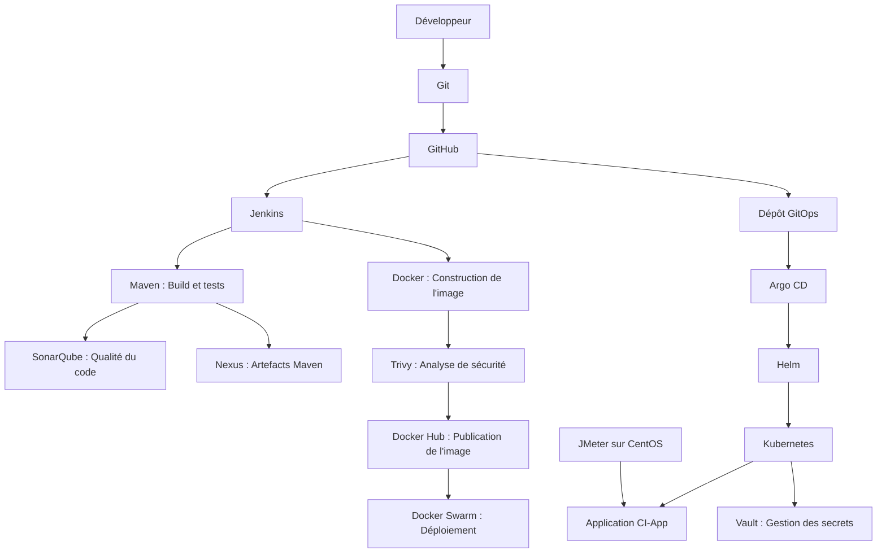

Cette architecture distingue les différents environnements de déploiement et les responsabilités de chaque outil.

### 23.2 Organisation des pipelines

Le laboratoire utilise plusieurs processus indépendants :

| Pipeline ou processus | Objectif |
|---|---|
| Jenkins CI | Compilation, tests, analyse SonarQube et publication Maven |
| Pipeline Docker / Swarm | Construction de l'image, contrôle de sécurité et déploiement Docker Swarm, selon les étapes configurées |
| Pipeline CD Kubernetes | Authentification Vault, mise à jour de la configuration Helm et synchronisation Argo CD |
| Tests JMeter | Tests de charge exécutés localement sur la VM CentOS |

Cette séparation permet de mieux identifier les responsabilités de chaque pipeline et de faciliter le diagnostic des erreurs.

## 24. Conteneurisation avec Docker

### 24.1 Présentation

Docker permet de transformer l'application Java en une image conteneurisée.

Cette image contient les éléments nécessaires à l'exécution de l'application et peut être utilisée dans différents environnements.

La conteneurisation apporte notamment :

- Une meilleure portabilité de l'application ;
- Une isolation de l'environnement d'exécution ;
- Une simplification du déploiement ;
- Une meilleure reproductibilité des environnements.

### 24.2 Construction de l'image Docker

Le projet utilise un Dockerfile pour définir les instructions de construction de l'image.

L'image de l'application est identifiée par :

```text
insafnemri/ci-app
```

Le processus de construction peut être représenté ainsi :

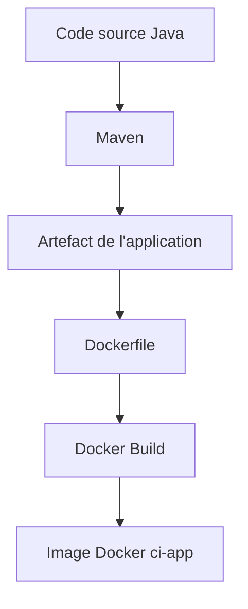

L'image construite constitue le support utilisé pour les déploiements sur les plateformes de conteneurisation.

## 25. Analyse de sécurité avec Trivy

### 25.1 Présentation

Trivy est un outil d'analyse de sécurité permettant notamment de détecter les vulnérabilités présentes dans les images Docker.

Il intervient dans le processus de contrôle de sécurité avant la publication ou le déploiement d'une image.

### 25.2 Fonctionnement

Le processus d'analyse suit les étapes suivantes :

1. Construction de l'image Docker ;
2. Analyse de l'image avec Trivy ;
3. Identification des vulnérabilités ;
4. Consultation du rapport d'analyse ;
5. Poursuite du processus selon les règles de sécurité définies.

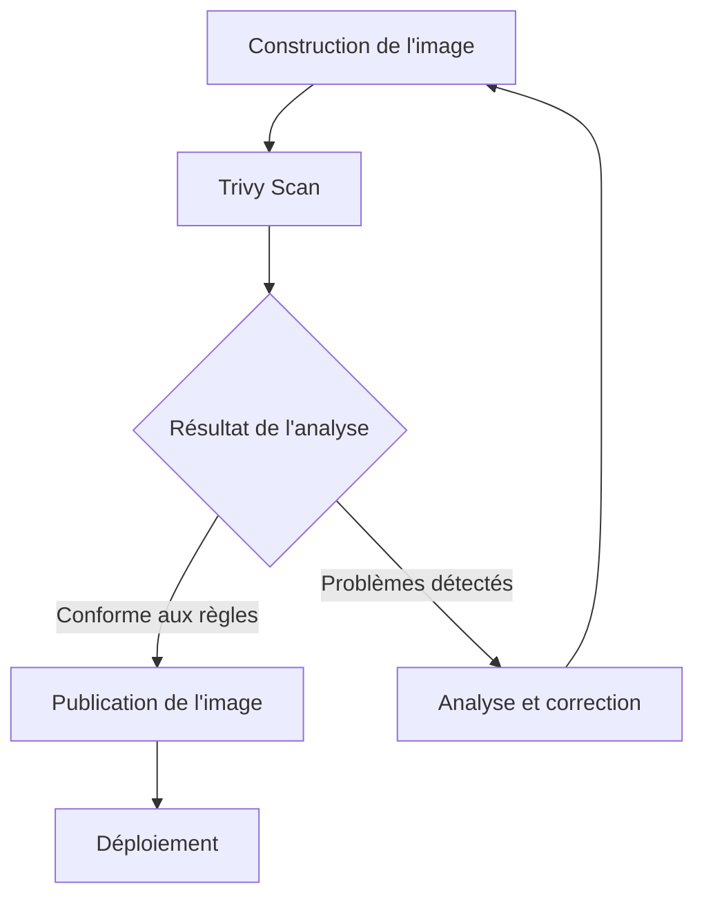

Trivy permet ainsi d'intégrer un contrôle de sécurité des images dans le cycle de livraison de l'application.

## 26. Publication de l'image sur Docker Hub

Après la construction et les contrôles prévus, l'image Docker peut être publiée sur Docker Hub.

Image utilisée :

```text
insafnemri/ci-app
```

Le flux de publication est le suivant :

```text
Code source
    |
    v
Docker Build
    |
    v
Image Docker
    |
    v
Trivy Scan
    |
    v
Docker Push
    |
    v
Docker Hub
```

Le registre Docker Hub permet de centraliser les images et de les rendre accessibles aux environnements de déploiement.

## 27. Déploiement avec Docker Swarm

### 27.1 Présentation

Docker Swarm est utilisé pour orchestrer les conteneurs Docker.

Il permet de gérer les services, les réplicas et les ports d'accès à l'application.

Dans ce laboratoire, le service applicatif est nommé :

```text
ci-app
```

Le déploiement utilise deux réplicas de l'application.

### 27.2 Architecture Docker Swarm

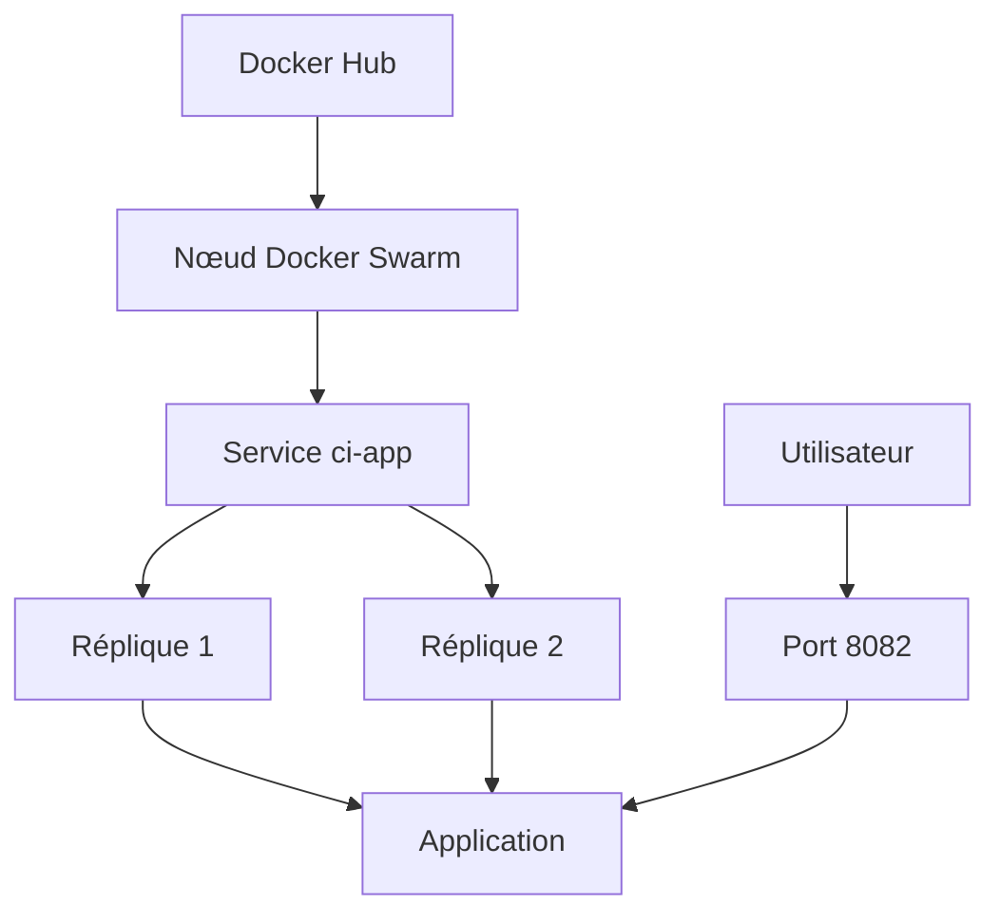

### 27.3 Vérification du déploiement

Les commandes suivantes permettent de vérifier le fonctionnement du service :

Vérifier les services :

```bash
docker service ls
```

Consulter les détails du service :

```bash
docker service inspect ci-app
```

Vérifier les réplicas :

```bash
docker service ps ci-app
```

Consulter les journaux :

```bash
docker service logs ci-app
```

L'objectif est de vérifier que le service est correctement déployé et que les deux réplicas sont opérationnels.

## 28. Orchestration avec Kubernetes

### 28.1 Présentation

Kubernetes est utilisé comme plateforme d'orchestration des conteneurs.

Il permet de gérer le cycle de vie des applications, leur disponibilité et leur exposition réseau.

Le laboratoire utilise un cluster Kubernetes constitué de plusieurs machines virtuelles.

### 28.2 Architecture du cluster

Le cluster comprend notamment les nœuds suivants :

| Nœud | Adresse IP | Rôle |
|---|---|---|
| k8s-control | 192.168.42.208 | Nœud de contrôle |
| k8s-worker | 192.168.121.104 | Nœud de travail |
| k8s-worker-node-1 | 192.168.42.213 | Nœud de travail |

Les adresses et états des nœuds doivent être vérifiés sur l'environnement au moment de la documentation.

### 28.3 Architecture Kubernetes

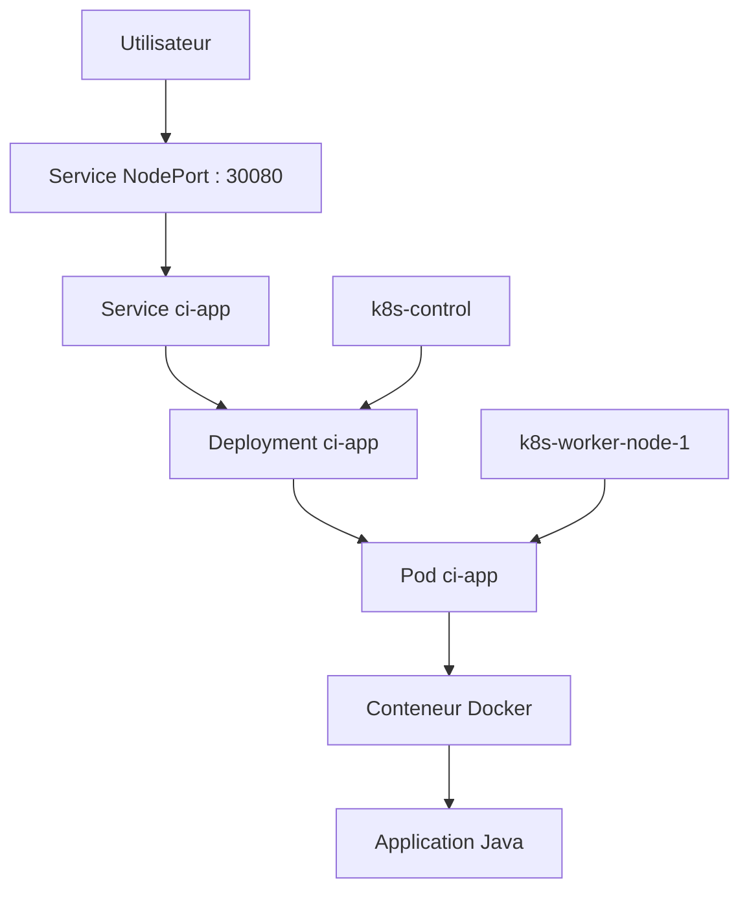

### 28.4 Vérification du cluster

Vérifier les nœuds :

```bash
kubectl get nodes -o wide
```

Vérifier les pods :

```bash
kubectl get pods -o wide
```

Vérifier les services :

```bash
kubectl get services
```

Vérifier les déploiements :

```bash
kubectl get deployments
```

Ces commandes permettent de contrôler l'état des ressources Kubernetes.

## 29. Gestion des applications avec Helm

### 29.1 Présentation

Helm est un gestionnaire de packages pour Kubernetes.

Il permet de regrouper les ressources Kubernetes d'une application dans un chart afin de simplifier leur installation et leur configuration.

Dans ce laboratoire, l'application CI-App est organisée dans le chart :

```text
helm/
└── ci-app/
    ├── Chart.yaml
    ├── values.yaml
    └── templates/
        ├── deployment.yaml
        ├── service.yaml
        └── serviceaccount.yaml
```

### 29.2 Fonctionnement de Helm

Le chart Helm regroupe les paramètres et les ressources nécessaires au déploiement de l'application.

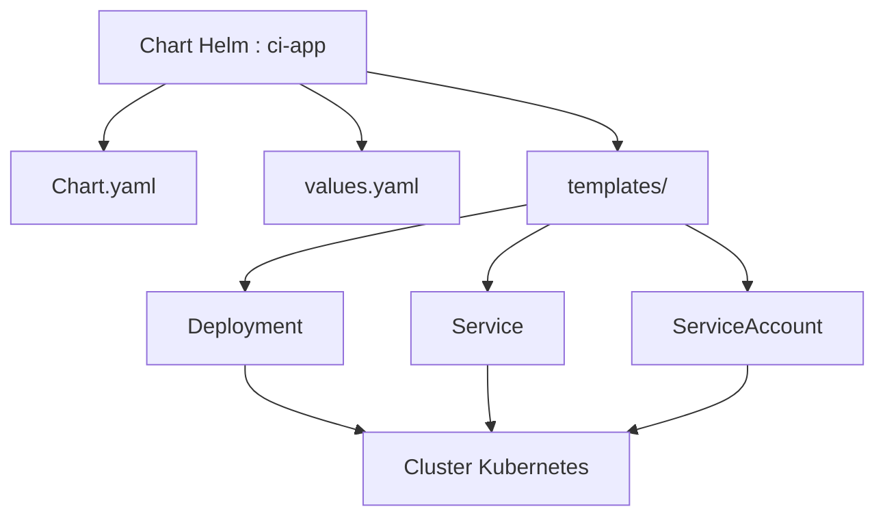

Le fichier `values.yaml` permet notamment de définir :

- Le nom de l'image Docker ;
- Le tag de l'image ;
- La politique de récupération de l'image ;
- Le nombre de réplicas ;
- La configuration des ports.

### 29.3 Commandes de vérification

Afficher les releases Helm :

```bash
helm list -A
```

Vérifier le chart :

```bash
helm lint helm/ci-app
```

Afficher les ressources générées :

```bash
helm template ci-app helm/ci-app
```

Mettre à jour le déploiement :

```bash
helm upgrade --install ci-app helm/ci-app
```

Helm permet ainsi de rendre les déploiements Kubernetes plus reproductibles et plus faciles à maintenir.

## 30. Gestion des secrets avec HashiCorp Vault

### 30.1 Présentation

HashiCorp Vault est utilisé pour centraliser la gestion des secrets.

Il permet de stocker et de contrôler l'accès aux informations sensibles utilisées par les applications et les processus d'automatisation.

Dans ce laboratoire, Vault est intégré au processus de déploiement Kubernetes.

### 30.2 Architecture Vault

Vault est déployé dans le cluster Kubernetes, dans l'espace de noms :

```text
vault
```

L'authentification Kubernetes permet à un service account autorisé d'obtenir un jeton Vault.

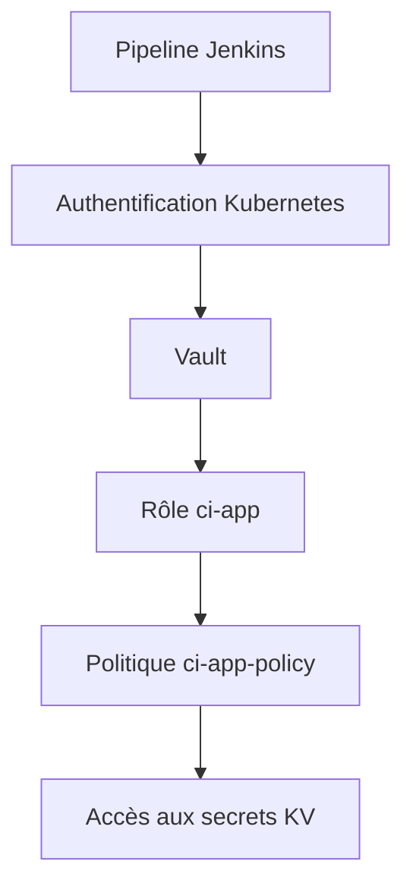

### 30.3 Authentification Kubernetes

Vault utilise le mécanisme Kubernetes Auth pour authentifier les workloads autorisés.

Les principaux éléments configurés sont :

- Le chemin d'authentification `kubernetes` ;
- Le rôle `ci-app` ;
- Le service account `ci-app` ;
- La politique `ci-app-policy` ;
- Le moteur de secrets KV.

Le chemin de stockage utilisé pour les secrets de l'application est :

```text
secret/data/ci-app
```

Cette configuration permet de contrôler les accès aux secrets selon les rôles et les politiques définis.

## 31. Déploiement GitOps avec Argo CD

### 31.1 Présentation

Argo CD est utilisé pour mettre en œuvre l'approche GitOps sur Kubernetes.

Il surveille le dépôt Git et compare l'état déclaré dans les fichiers de configuration avec l'état réel des ressources déployées dans le cluster.

Lorsque des modifications sont publiées dans Git, Argo CD peut synchroniser l'application avec la configuration déclarée.

### 31.2 Architecture GitOps

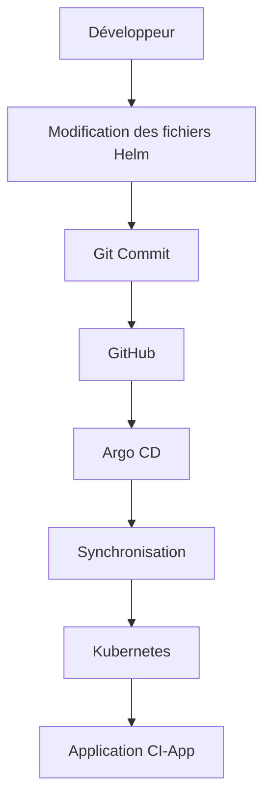

### 31.3 Application Argo CD

L'application déployée porte le nom :

```text
ci-app
```

Elle utilise le dépôt GitHub :

```text
INSAF-DEBUG/CI-Lab
```

Le chemin du chart Helm est :

```text
helm/ci-app
```

Argo CD utilise ce chemin pour suivre la configuration déclarée de l'application.

### 31.4 Vérification de l'application

Lister les applications Argo CD :

```bash
kubectl get applications -n argocd
```

Afficher les détails de l'application :

```bash
kubectl describe application ci-app -n argocd
```

Vérifier les ressources déployées :

```bash
kubectl get pods
kubectl get services
kubectl get deployments
```

Les états recherchés sont :

- Synchronisation : `Synced` ;
- Santé : `Healthy`.

Ces états indiquent que la configuration Git suivie par Argo CD est synchronisée et que les ressources sont considérées comme saines.

## 32. Pipeline CD Kubernetes avec Jenkins, Vault et Argo CD

### 32.1 Objectif

Un pipeline CD distinct est utilisé pour automatiser certaines opérations de livraison vers Kubernetes.

Il est séparé du pipeline CI et du déploiement Docker Swarm.

Son objectif est de mettre à jour la configuration Helm dans Git et de déclencher la synchronisation Argo CD.

### 32.2 Étapes du pipeline

Le processus est organisé autour des étapes suivantes :

1. Récupération du dépôt GitHub ;
2. Validation du tag de l'image Docker ;
3. Authentification auprès de Vault ;
4. Accès aux secrets autorisés ;
5. Mise à jour de la configuration Helm ;
6. Publication des modifications dans GitHub ;
7. Synchronisation de l'application avec Argo CD.

### 32.3 Schéma du pipeline

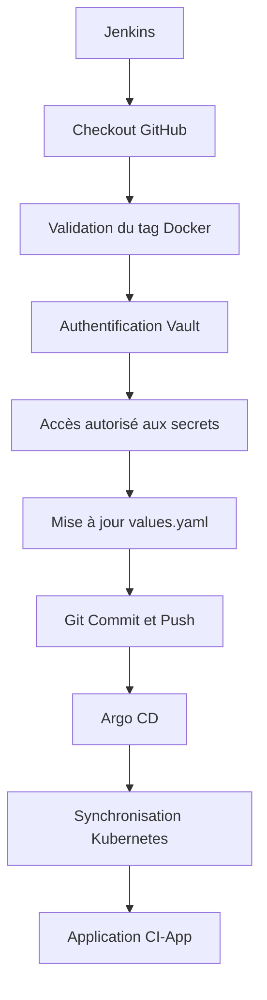

Cette organisation associe l'automatisation Jenkins, la gestion des secrets avec Vault et la livraison déclarative avec Argo CD.

## 33. Tests de charge avec Apache JMeter

### 33.1 Présentation

Apache JMeter est utilisé pour réaliser des tests de charge sur l'application CI-App.

Contrairement aux étapes de compilation, d'analyse et de déploiement, les tests de charge sont exécutés localement et indépendamment de Jenkins.

Ils sont lancés manuellement sur la machine CentOS lorsque cela est nécessaire.

Cette séparation permet de déclencher les tests de performance sans exécuter à nouveau l'ensemble du pipeline CI/CD.

### 33.2 Organisation des fichiers

Les scripts d'installation et d'exécution sont regroupés dans :

```text
scripts_Jmeter_Tests/
├── install-jmeter.sh
├── jmeter.conf
└── run-jmeter-tests.sh
```

Le scénario de test est conservé dans :

```text
tests/
└── jmeter/
    └── ci-app-load-test.jmx
```

### 33.3 Architecture des tests JMeter

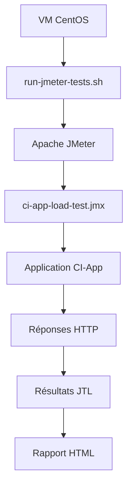

### 33.4 Rôle des fichiers

| Fichier | Fonction |
|---|---|
| `install-jmeter.sh` | Installe Apache JMeter |
| `jmeter.conf` | Centralise les paramètres et les chemins |
| `run-jmeter-tests.sh` | Lance les tests et génère les résultats |
| `ci-app-load-test.jmx` | Définit le scénario de charge |

### 33.5 Exécution locale

Les tests sont exécutés depuis la VM CentOS avec le compte applicatif dédié :

```bash
sudo -u jmeterapp bash scripts_Jmeter_Tests/run-jmeter-tests.sh
```

JMeter utilise le mode non graphique afin d'exécuter le scénario sans interface utilisateur.

### 33.6 Résultats des tests

Les résultats sont enregistrés dans :

```text
/opt/jmeter/results/
```

Les rapports HTML sont générés dans :

```text
/opt/jmeter/reports/
```

Les indicateurs analysés peuvent notamment comprendre :

- Le nombre de requêtes exécutées ;
- Le temps de réponse moyen ;
- Les temps de réponse minimum et maximum ;
- Le taux d'erreur ;
- Le débit ;
- Les percentiles de temps de réponse.

Les tests JMeter ne constituent pas une étape obligatoire du pipeline Jenkins. Ils sont réalisés à la demande, indépendamment du processus CI/CD.

## 34. Structure globale du dépôt GitHub

La structure du dépôt est organisée par domaine fonctionnel :

```text
CI-Lab/
│
├── Documentations/
│
├── architecture/
│   ├── 01-global-architecture.drawio
│   └── 01-global-architecture.png
│
├── argocd/
│
├── ci-app/
│   ├── src/
│   ├── pom.xml
│   ├── Dockerfile
│   ├── Jenkinsfile-CD-K8s-Vault-ArgoCD
│   └── ...
│
├── helm/
│   └── ci-app/
│       ├── Chart.yaml
│       ├── values.yaml
│       └── templates/
│
├── scripts_Jmeter_Tests/
│   ├── install-jmeter.sh
│   ├── jmeter.conf
│   └── run-jmeter-tests.sh
│
├── tests/
│   └── jmeter/
│       └── ci-app-load-test.jmx
│
├── Jenkinsfile_Tests
├── Jenkinsfile_Docker_Docker-Swarm_CD
├── README.md
└── .gitignore
```

Cette organisation permet de séparer :

- Le code source de l'application ;
- Les pipelines Jenkins ;
- Les configurations Kubernetes ;
- Les ressources Helm ;
- Les configurations Argo CD ;
- Les scripts de tests de charge.

## 35. Synthèse des technologies utilisées

| Technologie | Rôle dans le laboratoire |
|---|---|
| Git / GitHub | Gestion et hébergement du code source |
| Java / Maven | Construction et tests de l'application |
| Jenkins | Automatisation CI/CD |
| SonarQube | Analyse de la qualité du code |
| Nexus | Stockage des artefacts Maven |
| Docker | Conteneurisation |
| Trivy | Analyse de sécurité des images |
| Docker Hub | Registre d'images |
| Docker Swarm | Orchestration Docker |
| Kubernetes | Orchestration des conteneurs |
| Helm | Gestion des déploiements Kubernetes |
| HashiCorp Vault | Gestion des secrets |
| Argo CD | Déploiement GitOps |
| Apache JMeter | Tests de charge locaux |

## 36. Résultat global du laboratoire

Le laboratoire couvre désormais plusieurs étapes complémentaires du cycle de vie d'une application.

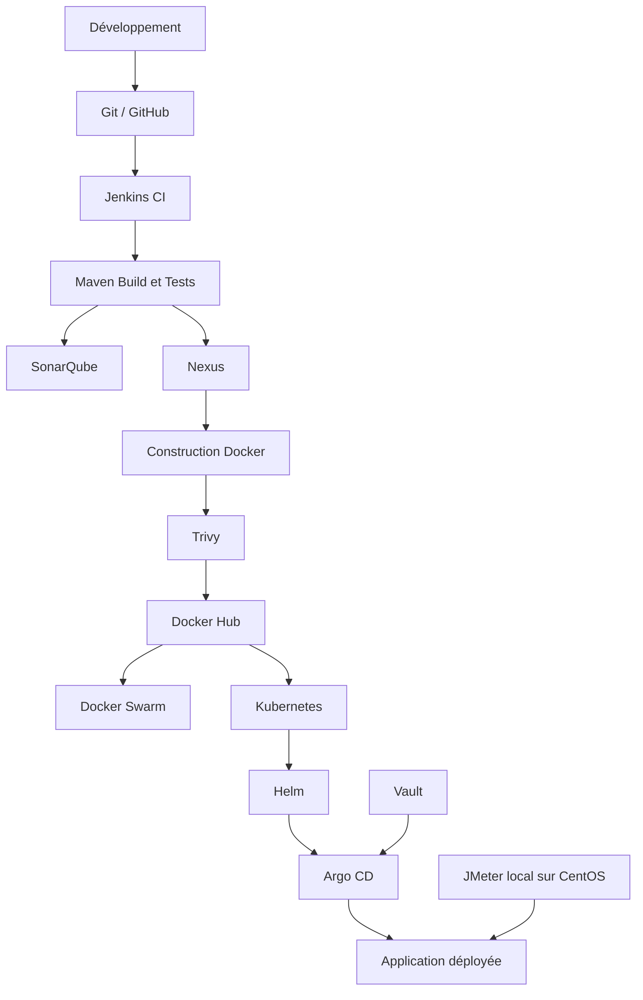

Le laboratoire permet ainsi de mettre en pratique :

- L'intégration continue ;
- L'analyse de la qualité du code ;
- La publication des artefacts ;
- La conteneurisation ;
- L'analyse de sécurité ;
- L'orchestration Docker ;
- L'orchestration Kubernetes ;
- La gestion des déploiements avec Helm ;
- La gestion sécurisée des secrets avec Vault ;
- Le déploiement GitOps avec Argo CD ;
- Les tests de charge indépendants avec Apache JMeter.

## 37. Conclusion générale

Ce laboratoire a permis de construire progressivement un environnement DevOps autour d'une application Java.

La première partie est consacrée à l'intégration continue avec Git, GitHub, Jenkins, Maven, SonarQube et Nexus.

La deuxième partie introduit Docker, Trivy et Docker Swarm afin de mettre en œuvre la conteneurisation, les contrôles de sécurité et l'orchestration des conteneurs.

La troisième partie porte sur Kubernetes et ses outils complémentaires. Helm facilite la gestion des ressources, Vault centralise les secrets et Argo CD permet d'appliquer les principes GitOps.

Enfin, Apache JMeter complète le laboratoire avec des tests de charge exécutés localement sur la VM CentOS, indépendamment de Jenkins.

L'ensemble constitue un environnement pratique permettant de comprendre les principales étapes d'un cycle DevOps, depuis la gestion du code source jusqu'au déploiement et à l'évaluation des performances de l'application.


 


